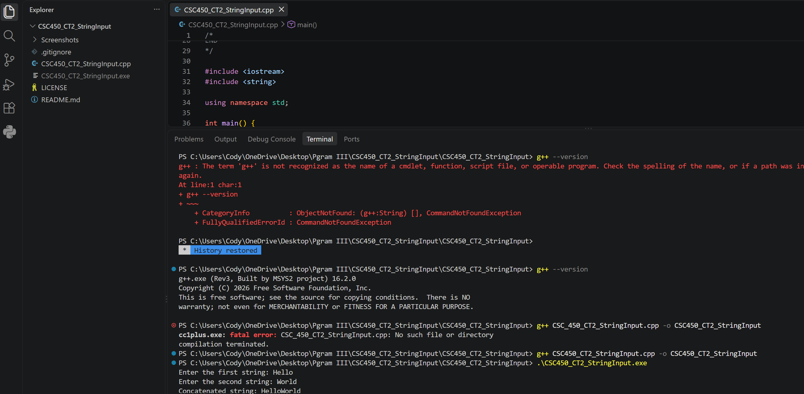
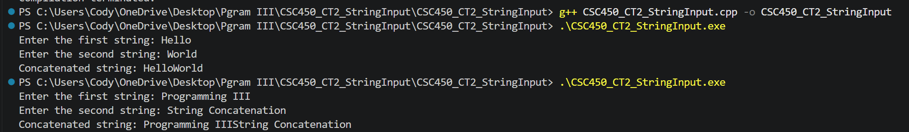
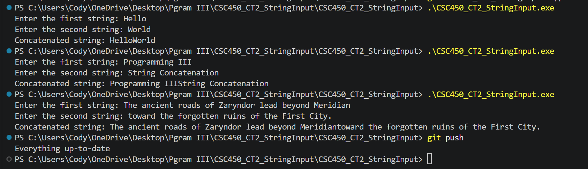

# C++ String Input and Concatenation

A C++ console application developed for **CSC450 — Programming III** at Colorado State University Global.

This project demonstrates how to accept string input from a user, concatenate two strings, and display the combined result using standard C++ input and output operations.

## Project Overview

The application prompts the user to enter two strings. It stores each input in a separate variable, combines them using the string concatenation operator (`+`), and displays the resulting string.

The assignment focuses on fundamental C++ concepts, including:

- Declaring and initializing string variables
- Accepting user input with `getline()`
- Working with the `std::string` data type
- Concatenating strings using the `+` operator
- Displaying console output with `cout`
- Developing program logic using pseudocode

## Technologies Used

- **C++** — Programming language
- **C++ Standard Library** — String handling and console input/output
- **MinGW-w64 / g++** — C++ compiler
- **Visual Studio Code** — Code editing and testing
- **Git and GitHub** — Version control and documentation

## Project Structure

```text
cpp-string-input-and-concatenation/
├── CSC450_CT2_StringInput.cpp
├── Screenshots/
│   ├── CSC450_CT2_Execution_1_Short_Strings.png
│   ├── CSC450_CT2_Execution_2_Medium_Strings.png
│   └── CSC450_CT2_Execution_3_Long_Strings.png
├── .gitignore
├── LICENSE
└── README.md
```

## How the Program Works

The program follows five basic steps:

1. Declare three string variables.
2. Prompt the user to enter the first string.
3. Prompt the user to enter the second string.
4. Concatenate the two strings using the `+` operator.
5. Display the combined string in the console.

### String Input

The program uses `getline()` to read the user's input:

```cpp
cout << "Enter the first string: ";
getline(cin, firstString);

cout << "Enter the second string: ";
getline(cin, secondString);
```

Unlike the extraction operator (`cin >>`), `getline()` can accept strings containing spaces.

This allows users to enter individual words, phrases, or complete sentences.

### String Concatenation

The two strings are combined using:

```cpp
combinedString = firstString + secondString;
```

The `+` operator joins the strings exactly as entered.

**Note:** The program does not automatically insert a space or separator between the strings. If a space is desired, it must be included in the input.

### Displaying the Result

The program displays the concatenated string using:

```cpp
cout << "Concatenated string: " << combinedString << endl;
```

## Pseudocode

The original source file includes pseudocode describing the program's logic.

```text
START

DECLARE firstString as string
DECLARE secondString as string
DECLARE combinedString as string

PROMPT user to enter first string
GET firstString

PROMPT user to enter second string
GET secondString

SET combinedString to firstString + secondString

PRINT combinedString

END
```

This pseudocode outlines the program's sequence before implementation.

## How to Compile and Run

### Requirements

- A C++ compiler, such as g++ through MinGW-w64
- A terminal or command prompt
- Windows, Linux, or macOS with a compatible C++ compiler

### Step 1 — Clone the Repository

```bash
git clone https://github.com/Tentei06/cpp-string-input-and-concatenation.git
```

Navigate into the project directory:

```bash
cd cpp-string-input-and-concatenation
```

### Step 2 — Compile the Program

```bash
g++ CSC450_CT2_StringInput.cpp -o string-input
```

### Step 3 — Run the Program

**Windows (PowerShell):**

```powershell
.\string-input.exe
```

**Linux or macOS:**

```bash
./string-input
```

The application will prompt you to enter two strings and display the concatenated result.

## Example Execution

The following example demonstrates the program's behavior:

```text
Enter the first string: Hello
Enter the second string: World
Concatenated string: HelloWorld
```

Because the program concatenates the strings directly, no space is inserted between `Hello` and `World`.

To include a separator, the user can enter a space as part of one of the input strings.

## Testing and Verification

The original coursework included three execution scenarios demonstrating string concatenation with inputs of different lengths.

| Test Scenario | Purpose |
|---------------|---------|
| Short strings | Verify basic string input and concatenation |
| Medium strings | Verify handling of longer input |
| Long strings | Verify concatenation of extended text |

The screenshots below document the original program execution.

### Test 1 — Short Strings



### Test 2 — Medium Strings



### Test 3 — Long Strings



These tests demonstrate the program's ability to accept and concatenate strings of varying lengths.

## Key Programming Concepts

### The std::string Data Type

C++ provides the `std::string` class for storing and manipulating text.

The program declares three string variables:

```cpp
string firstString;
string secondString;
string combinedString;
```

The variables store the two user inputs and their combined result.

### getline() and Console Input

The `getline()` function reads an entire line of text from the input stream.

It is useful when working with phrases or sentences because it does not stop reading at the first space.

### String Concatenation

String concatenation combines two or more strings into a single string.

In this program, the `+` operator joins the first and second input strings without modifying their contents.

### Console Output

The application uses `cout` to display prompts and results.

The insertion operator (`<<`) sends text and variable values to the console.

### Program Structure

The application contains a single `main()` function that handles input, processing, and output.

The program ends with `return 0`, indicating successful completion.

## Development Process

The original assignment involved:

1. Reviewing the program requirements.
2. Writing pseudocode to outline the application.
3. Declaring variables to store user input.
4. Implementing string input with `getline()`.
5. Concatenating the input strings.
6. Displaying the resulting string.
7. Compiling and executing the program.
8. Testing the application with multiple input lengths.
9. Capturing screenshots of successful execution.

The project emphasizes understanding basic C++ input and string operations before progressing to more complex programming concepts.

## Limitations

This application is an introductory console-based exercise.

- The program accepts exactly two strings per execution.
- Strings are concatenated without an automatically inserted separator.
- Input is not saved to a file or database.
- The application does not provide a menu or repeat the operation.
- No graphical user interface is included.

These limitations reflect the original assignment's scope.

## Educational Context

This project was developed as the **Module 2 Critical Thinking assignment** for CSC450 — Programming III at Colorado State University Global.

It demonstrates foundational skills in user input, string manipulation, console output, pseudocode, and functional testing.

The original program structure and assignment requirements have been preserved.

## License

This project is licensed under the MIT License. See [LICENSE](LICENSE) for details.
